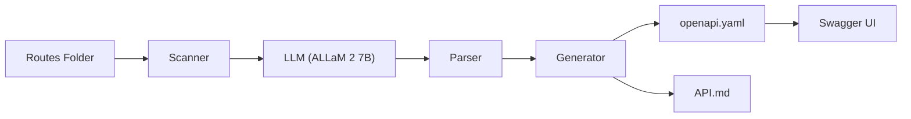
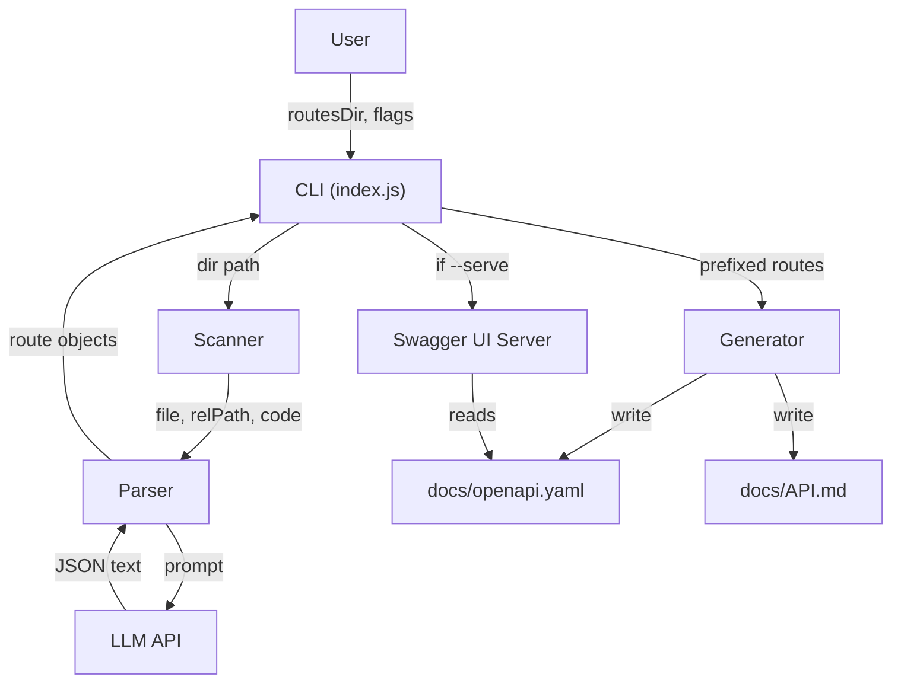
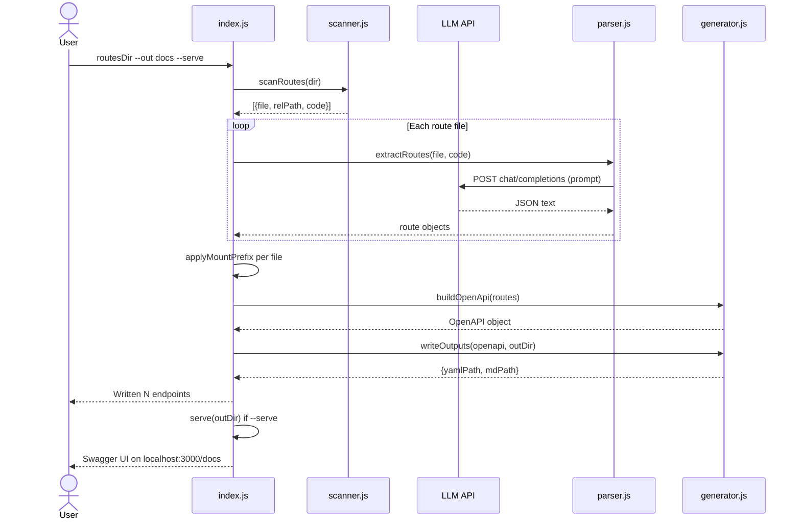

# API Docs Generator

A Node.js CLI tool that scans Express route files, sends them to a large language model, and generates OpenAPI 3.0 documentation automatically.

## Problem & Target User

Writing and maintaining API documentation is tedious and often falls out of sync with the actual code. **API Docs Generator** solves this by reading your Express route source code and producing an up-to-date `openapi.yaml` spec and a human-readable `API.md` — in seconds.

**Target users:** Solo developers, small teams, and hackathon participants who need quick, accurate API docs without writing them by hand.

## Features

- **Recursive route scanning** — finds all `.js` route files in a directory tree
- **LLM-powered extraction** — infers HTTP methods, paths, parameters, request bodies, and responses from source code
- **OpenAPI 3.0.3 output** — valid, spec-compliant `openapi.yaml`
- **Markdown docs** — auto-generated `API.md` with endpoint table and per-route details
- **Swagger UI** — optional `--serve` flag launches an interactive API explorer at `/docs`
- **Sanitisation** — post-processes LLM output to fix common issues (Express `:id` → OpenAPI `{id}`, missing path params, malformed request bodies)
- **Mount prefix inference** — derives route prefixes from filenames (`users.js` → `/users`)
- **Rate-limit retry** — on HTTP 429 waits for the `retry-after` header (default 5s) and retries up to 3 times

## AI Component

| Property | Detail |
|----------|--------|
| **Model** | ALLaM 2 7B |
| **Model ID** | `allam-2-7b` |
| **Parameters** | 7 billion |
| **Developer** | SDAIA (Saudi Data & AI Authority) |
| **API provider** | Groq (cloud, OpenAI-compatible chat completions) |
| **Temperature** | 0 (deterministic) |
| **Weights / licence** | Open weights published by SDAIA on Hugging Face (`ALLaM-AI/ALLaM-7B-Instruct-preview`); licence terms are in that repository's LICENSE file (verify before reuse). Groq serves it as `allam-2-7b`. |
| **Alternative** | Ollama with `qwen2.5-coder:7b` — swappable via env vars, untested |

**Role in the tool:** The LLM is the core of the pipeline. It receives raw Express route source code and infers structured OpenAPI operation descriptors (method, path, summary, parameters, request body, responses) as a JSON array. The tool then sanitises, merges, and writes the output. Without the LLM, there is no documentation — it is not a cosmetic add-on.

## Architecture

### System Flowchart



### Data Flow Diagram



### Sequence Diagram



## Setup & Usage

### Prerequisites

- Node.js 18+ (uses built-in `fetch`)
- A Groq API key **or** a local Ollama instance

### Installation

```bash
git clone https://github.com/muneeb1397/api-docs-generator.git
cd api-docs-generator
npm install
```

### Environment Variables

Copy `.env.example` to `.env` and fill in your values:

| Variable | Description | Default |
|----------|-------------|---------|
| `GROQ_API_KEY` | Your Groq API key | *(required for Groq)* |
| `PROVIDER` | `groq` or `ollama` | `groq` |
| `MODEL` | Model ID to use | `allam-2-7b` |
| `OLLAMA_URL` | Ollama server URL | `http://localhost:11434` |

> The `docs/` output folder is gitignored. Run the tool (below) to generate it.

### Run

```bash
# Generate docs
node index.js ./examples/sample-api/routes --out ./docs

# Generate docs + launch Swagger UI
node index.js ./examples/sample-api/routes --out ./docs --serve

# Validate the generated spec
npm run validate
```

## Testing & Findings

### Summary

```bash
npm test
```

This runs the full pipeline (generate → validate → assert endpoints) against the sample API.

| Endpoint | Expected | Result |
|----------|----------|--------|
| GET /users | present | PASS |
| POST /users | present | PASS |
| GET /users/{id} | present | PASS |
| PUT /users/{id} | present | PASS |
| DELETE /users/{id} | present | PASS |
| GET /products | present | PASS |

> **6/6 endpoints present, 0 unexpected.** See [TESTS.md](TESTS.md) for the full template and limitations.

### Post-Processing Required

The raw LLM output needed several sanitisation fixes, implemented in `src/generator.js` and `index.js`:

| Issue | Cause | Fix |
|-------|-------|-----|
| `:id` instead of `{id}` | Model returns Express syntax | `normaliseRoutePath()` converts `:param` → `{param}` |
| Missing mount prefix | Model sees one file, not the app's `app.use()` | `applyMountPrefix()` in `index.js` derives prefix from filename |
| Malformed parameters | Model sometimes returns request body schema as parameters | `isValidParam()` + `sanitiseParam()` filter and normalise |
| Stray keys in requestBody | Model nests `responses` inside `requestBody` | `sanitiseRequestBody()` keeps only `content` |
| Missing path params | Model omits `{id}` from parameters array | `ensurePathParams()` auto-adds them |

## Limitations

- **Mount prefix is inferred from the filename** — the model sees one route file at a time and has no knowledge of `app.use('/users', ...)`. The prefix is derived heuristically (`users.js` → `/users`). Nested directories or unconventional naming may produce incorrect prefixes.
- **Hallucinated schemas** — the 7B model may invent response schemas, status codes, or descriptions that don't match the actual code.
- **7B accuracy** — smaller models produce less reliable output than larger ones. The sanitisation layer compensates but cannot catch all errors.
- **Rate limits** — Groq's free tier has request-per-minute limits. The tool retries on 429 (up to 3 times) but large projects may require pacing.
- **One file at a time** — each route file is processed independently. Cross-file context (shared middleware, auth, models) is not captured.
- **No runtime analysis** — the tool reads source code statically. Dynamically registered routes are not detected.

## AI-Assisted Development Disclosure

This project was developed with the assistance of **Google Antigravity**, an AI-powered coding assistant. Antigravity helped with code generation, debugging, and documentation across all development steps.

## Team

**Solo project** by **Muhammad Muneeb Ur Rehman** — all design, implementation, testing, and documentation.

## License

[MIT](LICENSE) © 2026 Muhammad Muneeb Ur Rehman

## Acknowledgements

- [Groq](https://groq.com/) — fast LLM inference API
- [SDAIA](https://sdaia.gov.sa/) — ALLaM 2 language model
- [Ollama](https://ollama.com/) — local LLM runtime
- [Qwen](https://github.com/QwenLM/Qwen2.5-Coder) — alternative coder model
- [js-yaml](https://github.com/nodeca/js-yaml) — YAML serialisation
- [swagger-ui-express](https://github.com/scottie1984/swagger-ui-express) — Swagger UI middleware
- [Express](https://expressjs.com/) — web framework
- [@apidevtools/swagger-cli](https://github.com/APIDevTools/swagger-cli) — OpenAPI validation
